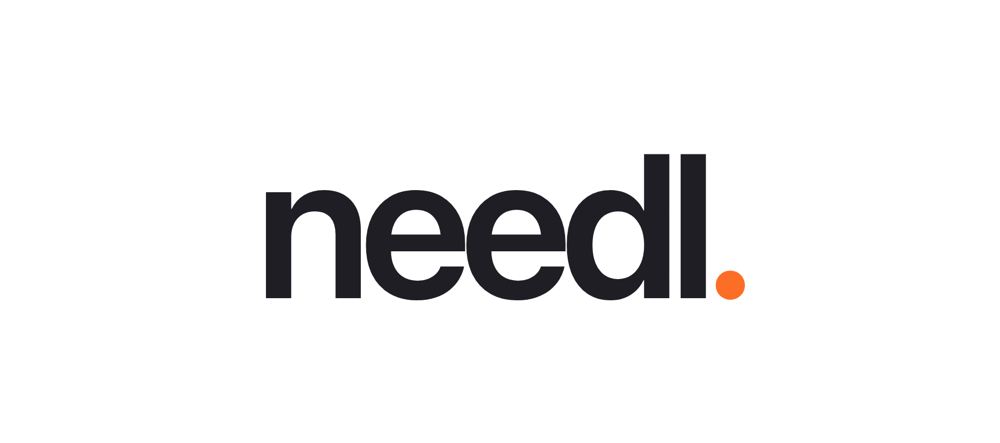

<p align="center">
  <a href="https://needl.dev">
    
  </a>
</p>

<p align="center">
  <strong>Assertions for your business, not just your code.</strong><br>
  Say what must always be true across your tools. Needl watches every event and hands a broken rule straight to a GitLab Duo agent.
</p>

<p align="center">
  <a href="https://github.com/kavishsathia/needl/actions/workflows/ci.yml"></a>
  <a href="LICENSE"></a>
  
  
  <a href="https://needl.dev"></a>
  
  <a href="CONTRIBUTING.md"></a>
</p>

<p align="center">
  <a href="https://needl.dev">Website</a> ·
  <a href="docs/use-cases.md">Use cases</a> ·
  <a href="docs/rule-language.md">Rule language</a> ·
  <a href="docs/providers.md">Integrations</a> ·
  <a href="CONTRIBUTING.md">Contributing</a>
</p>

---

## Why

In the past few years, software development has shifted fast: coding agents now generate almost all of our code. The catch is that we can't keep up with how quickly that code gets produced. The agent writes code, we skim it, say "LGTM," and move on. The inevitable result is that we, as developers, lose our mental model of the codebase. And in a code-centric business, losing the map of your codebase means losing your intuition for how your business actually operates. Worse, you may not even know what you don't know, because the agent made the decision for you. Maybe it did ask, but the transcript was so long that you missed the question and just said "go ahead."

On top of that, we're now handing agents the workflows we were doing by hand just six months ago: deployments, checking production error logs, flipping feature flags. It's like putting an agent in the driver's seat, except the destination isn't a simple address. It's something fuzzier, like "keep customers happy."

It's easy to see how a business run this way becomes a black box to the people who are supposed to manage it. And the thing about a black box is that you never know what comes out of it... until it does. It could be a customer who never gets their refund, a "fixed" issue that's still happening in production, or something as simple as a push to production on a Friday evening.

## What it does

We've actually solved this problem before, in code. Developers use `assert` in places where a failure means their assumptions about the code were wrong.

**Needl takes the same idea and zooms out to the level of the business.** You assert things that should always be true, and you get notified the moment one isn't, before it turns into churn, unhappy customers, or a hit to the bottom line.

For example, say you track errors in Sentry and ship code through GitLab. You could assert that once a GitLab MR referencing a Sentry issue is merged, that issue shouldn't show up again. If it does, you find out before you tell a customer the fix is live when it actually fixed nothing. That protects more than your reputation and revenue. It protects your relationship with the customer, who comes to see you as the team that knows what it's doing: reliable and trustworthy.

In Needl, that assertion reads like this:

```text
rule "Once a fix for an issue is deployed to {environment}, errors tagged with that issue must never appear there again"
input environment: text = "production"
always (
  gitlab.deployment(status = "success", environment = $environment) bind key = ref.issue_key
  -> never sentry.error(tags.linear_issue.issue_key = key, environment = $environment)
)
```

You don't have to write it by hand. Describe the rule in plain English and Needl's authoring agent drafts it, a checker verifies it, and it comes back to you in English with its choices as dropdowns, paused until you turn it on.

## How it works

Once a rule is on, nobody has to sit and watch it. Needl listens to the tools' own webhooks, checks each event against every rule as it arrives, and when a rule breaks it saves the evidence and hands the problem straight to a GitLab Duo agent. Nobody has to triage an alert, copy a stack trace into a chat or write a prompt. What the team comes back to is a draft merge request with the evidence behind it.

```text
  GitLab · Sentry · Linear · LaunchDarkly · PostHog · Stripe · Intercom
                               │  signed webhooks
                               ▼
              verify signature ─► normalize event ─► dedupe + store
                               │
                               ▼
                 check the event against every active rule
                               │
              ┌────────────────┴────────────────┐
              ▼                                 ▼
          rule holds                       rule breaks
        (keep watching)                         │
                                                ▼
                              save the break + the events behind it
                                                │
                                                ▼
                               start the team's GitLab Duo flow
                                                │
                                                ▼
                               draft merge request, ready for review
```

Here is that loop on the Sentry example. A branch for issue `ENG-42` is merged and deployed to production. Needl sees GitLab's deployment event, and from then on it holds Sentry to the rule for that issue. Two days later, Sentry reports an error tagged `ENG-42` in production. That one event breaks the rule. Needl stores the break together with the events that led to it, and in the same request starts the GitLab Duo flow the team chose, with that record in the flow's instructions. The flow reads the record and the code, then opens a draft merge request with a fix and explains what it changed and why. The merge request appears on the rule's card. Needl doesn't mark the problem solved because an agent finished; the rule keeps watching.

**A person steps in at the point where judgement matters: reviewing the fix.** By default the agent is told not to merge or deploy, so its merge request goes through the team's normal review. Teams can rewrite those instructions, or turn automatic starts off and start the agent from a break with one click.

## What you can assert

Rules can span any of the seven integrations, joined on shared values like an issue key. A few from [the use-case catalogue](docs/use-cases.md):

| Area | Rule |
| --- | --- |
| Engineering | When a pipeline on `main` fails, a passing pipeline must follow within 1 hour |
| Engineering | Once a branch for an issue is deployed, that Linear issue must be completed within 1 day |
| Engineering | For 30 minutes after a flag is turned on in production, no critical metric alert may fire |
| Billing | An invoice must never be paid by a second payment |
| Billing | Once a payment is disputed, it must never be charged again |
| Support | Every conversation a customer starts must get a teammate reply within 1 hour |
| Privacy | Once a person deletes their account, no further analytics events may arrive for them |

Needl only runs rules that a single event, or a time limit passing, can break, so every rule can actually fire. See the [safety policy](docs/safety-product-policy.md) for why.

### Integrations

| Tool | What Needl hears |
| --- | --- |
| **GitLab** | deployments, pipelines, pushes, merge requests, issues |
| **Sentry** | errors, issues, issue and metric alerts |
| **Linear** | issues, comments, SLA breaches |
| **LaunchDarkly** | flag, environment and project changes |
| **PostHog** | product analytics events |
| **Stripe** | invoices, charges, payment intents, disputes, subscriptions |
| **Intercom** | conversations, tickets, contacts |

Every webhook is checked against its provider's real signing scheme before it is parsed. Details per provider are in [docs/providers.md](docs/providers.md).

## Quick start

You need Node.js 22.13 or later and a local Postgres.

```bash
git clone https://github.com/kavishsathia/needl.git
cd needl
npm ci
npm --prefix apps/web ci --legacy-peer-deps

createdb needl
echo 'DATABASE_URL=postgres://localhost:5432/needl' > .env

npm run web:dev
```

Open <http://127.0.0.1:5173>, create an account, and start from one of the worked examples. To let Needl draft rules from plain English, add `OPENAI_API_KEY` to `.env`. All configuration options are in [.env.example](.env.example) and [docs/deployment.md](docs/deployment.md).

### Try it without real accounts

The webhook simulator sends any event in the catalogue as that provider's real, signed webhook, and can replay a "break it" or "keep it" story for each example rule.

```bash
npm run sim:setup                  # generate signing secrets
npm run sim:web                    # start Needl with those secrets
# sign up, then read your tenantId from GET /api/workspace
npm run sim:setup -- <tenantId>
npm run sim:register               # add the seven integrations
npm run sim                        # open http://127.0.0.1:4180
```

## Project layout

```text
src/              @needl/integrations: webhook adapters, receiver, rule language, LTL runtime
apps/web/         the Needl app: React frontend + API (auth, rules, ingestion, GitLab Duo flows)
apps/simulator/   local control panel that sends signed provider webhooks
examples/         a minimal webhook server and an LTL demo
tests/            unit, persistence and end-to-end tests for the package
docs/             rule language, semantics, providers, deployment
```

Under the app is a standalone TypeScript package, `@needl/integrations`, which does signature verification, event normalization and durable LTL monitoring. You can use it on its own; see [docs/library.md](docs/library.md).

## Documentation

- [Rule language](docs/rule-language.md): how rules are written and checked
- [Use cases](docs/use-cases.md): rules you can paste in today
- [Integrations](docs/providers.md): events, signing schemes and setup per provider
- [LTL semantics](docs/ltl-semantics.md): exactly what the monitor guarantees
- [Safety policy](docs/safety-product-policy.md): which rules Needl accepts and why
- [Deployment](docs/deployment.md): hosting on Vercel, environment and secrets
- [Library](docs/library.md): using `@needl/integrations` directly

## Development

```bash
npm run check        # package: typecheck, tests, build, smoke test
npm run web:test     # app tests (needs a local Postgres)
npm run web:build    # app typecheck + production build
npm run web:e2e      # browser tests with Playwright
```

CI runs all of these on every push and pull request. See [CONTRIBUTING.md](CONTRIBUTING.md) before opening a PR.

## Contributing

Issues and pull requests are welcome. Please read the [contributing guide](CONTRIBUTING.md) and follow the [code of conduct](CODE_OF_CONDUCT.md). To report a security issue, see [SECURITY.md](SECURITY.md).

## License

[MIT](LICENSE) © Kavish Sathia
